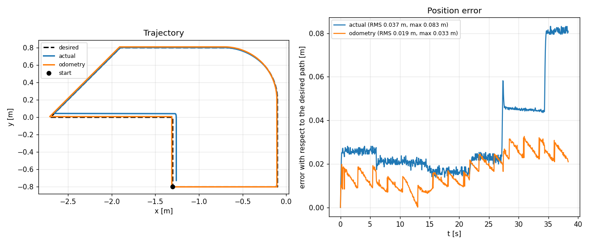
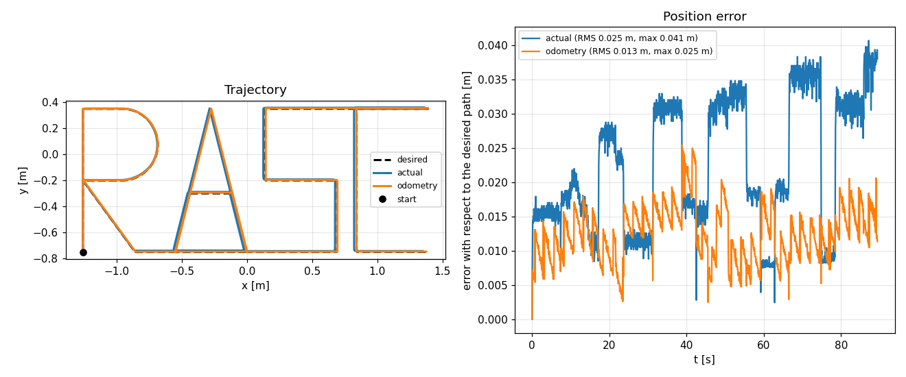

# Workshop 3 — Robot omnidireccional con ruedas mecanum

**Grupo 14**
- Ricardo (R)
- Alexa (A)
- Steven (S)
- Cristhian (C)

**Robot:** Clearpath Dingo-O (4 ruedas mecanum a 45°)
**Entorno:** Ubuntu 24.04 · ROS 2 Jazzy · Gazebo Harmonic 8.15
**Repositorio base:** <https://github.com/davatorr1009/workshop_03>

---

## 1. Introducción

El workshop tiene dos partes. En la primera se reemplaza el controlador de fábrica
del Dingo-O por uno propio: se implementa la cinemática inversa de las ruedas
mecanum, se sigue una figura y se comparan tres poses (deseada, real en Gazebo y
odometría de ruedas). En la segunda se usa el controlador de fábrica para mapear
un entorno pequeño y uno grande con SLAM.

El robot se modela en el plano. El frame del robot tiene **x hacia adelante**,
**y hacia la izquierda** y **ω positivo en sentido antihorario**.

---

## 2. Modelo cinemático

### 2.1 De mundo a robot

La trayectoria se define en el frame del mundo. Para seguirla hay que expresar la
velocidad en el frame del robot, que está rotado un ángulo θ:

$$
\begin{bmatrix} v_x \\ v_y \end{bmatrix} =
\begin{bmatrix} \cos\theta & \sin\theta \\ -\sin\theta & \cos\theta \end{bmatrix}
\begin{bmatrix} \dot{x} \\ \dot{y} \end{bmatrix},
\qquad \omega = \dot{\theta}
$$

### 2.2 Cinemática inversa (robot → ruedas)

Con rodillos a 45° y las cuatro ruedas en configuración X:

$$
\begin{bmatrix} \omega_{fl} \\ \omega_{fr} \\ \omega_{rl} \\ \omega_{rr} \end{bmatrix}
= \frac{1}{r}
\begin{bmatrix}
1 & -1 & -(l_x+l_y) \\
1 &  1 &  (l_x+l_y) \\
1 &  1 & -(l_x+l_y) \\
1 & -1 &  (l_x+l_y)
\end{bmatrix}
\begin{bmatrix} v_x \\ v_y \\ \omega \end{bmatrix}
$$

con $r = 0.05$ m, $l_x = 0.285$ m y $l_y = 0.1854$ m (dimensiones del Dingo-O).

### 2.3 Cinemática directa (ruedas → odometría)

Es la inversa de la matriz anterior y es la que usa el `plotter` para integrar la
odometría:

$$
v_x = \frac{r}{4}(\omega_{fl}+\omega_{fr}+\omega_{rl}+\omega_{rr}), \quad
v_y = \frac{r}{4}(-\omega_{fl}+\omega_{fr}+\omega_{rl}-\omega_{rr}), \quad
\omega = \frac{r}{4(l_x+l_y)}(-\omega_{fl}+\omega_{fr}-\omega_{rl}+\omega_{rr})
$$

La pose se integra con Euler en el frame `odom`:

$$
x_{k+1} = x_k + (\cos\theta_k\, v_x - \sin\theta_k\, v_y)\,\Delta t
$$
$$
y_{k+1} = y_k + (\sin\theta_k\, v_x + \cos\theta_k\, v_y)\,\Delta t
$$
$$
\theta_{k+1} = \theta_k + \omega\,\Delta t
$$

### 2.4 Saturación

Se agregó una saturación **proporcional**: si una rueda supera
`WHEEL_MAX = 15 rad/s`, se escalan las cuatro por el mismo factor. Recortar solo
la rueda más rápida cambiaría la dirección del movimiento; escalar todas la
conserva.

---

## 3. Implementación

### 3.1 Archivos modificados

| Archivo | Cambio |
|---|---|
| `omni_workshop/omni_workshop/self_controller.py` | `world_to_robot`, `inverse_kinematics`, `forward_kinematics`, `saturate` |
| `omni_workshop/omni_workshop/trajectory.py` | figuras `grupo14` y `RASC`, velocidad `LETTER_SPEED` |
| `omni_workshop/launch/workshop.launch.py` | argumentos `x`, `y`, `yaw` para elegir la pose inicial |
| `omni_workshop/omni_workshop/explore.py` | exploración automática por fronteras (bonus) |
| `omni_workshop/tools/*` | validación de cinemática, figuras y planos |

### 3.2 Validación de la cinemática

`tools/test_kinematics.py` comprueba:

1. **Ida y vuelta** IK → FK para 1000 velocidades aleatorias: error máximo
   `4.4e-16`.
2. **Casos conocidos**: avance (las 4 ruedas iguales), giro puro (izquierdas
   atrás, derechas adelante) y desplazamiento lateral (diagonales opuestas).
3. **Saturación**: se conservan las proporciones entre ruedas.

### 3.3 Figura propia

`grupo14` combina las cuatro primitivas (`line`, `diagonal`, `arc`, `turn`), es
cerrada y mide 2.60 × 1.60 m. Se verificó que el error de cierre es 0.00 cm y que
no hay discontinuidades (`tools/validate_figures.py`).

### 3.4 Iniciales R A S C

La palabra se dibuja en una sola pasada, con letras de 0.55 × 1.10 m y 0.15 m de
separación (2.65 m en total). El robot **no gira**: mantiene la orientación y se
traslada en x e y, que es exactamente lo que permiten las ruedas mecanum.

| Letra | Trazo |
|---|---|
| **R** | tallo, barra superior, arco de 180° (radio 0.275 m), regreso al tallo y pierna diagonal |
| **A** | dos piernas, base y travesaño horizontal a 0.45 m |
| **S** | barra inferior, lado derecho inferior, barra media, lado izquierdo superior, barra superior |
| **C** | barra superior, lado izquierdo y barra inferior |

Los conectores entre letras van por la línea de base (R→A, A→S) y por el borde
superior (S→C), de modo que no cruzan ningún trazo.

---

## 4. Resultados — Parte 1

Se corrieron las dos figuras en Gazebo con el controlador propio y el `plotter`
guardó un PNG por corrida (tres curvas + error instantáneo).

| Figura | Duración | RMS pose real | Error máx. real | RMS odometría | Error máx. odometría |
|---|---|---|---|---|---|
| `grupo14` | 38.4 s | **0.037 m** | 0.083 m | **0.019 m** | 0.033 m |
| `RASC` | 89.4 s | **0.025 m** | 0.041 m | **0.013 m** | 0.025 m |



*Figura propia: rectángulo con esquina redondeada y retorno diagonal. El robot
vuelve al punto de partida (error de cierre < 1 cm).*



*Iniciales R A S C dibujadas sin girar: el robot solo se traslada en x e y.*

Las tres curvas que genera el `plotter` son:

| Color | Pose | Fuente |
|---|---|---|
| negro discontinuo | deseada | `trajectory.py` |
| azul | real | pose de Gazebo (`/workshop/ground_truth`) |
| naranja | odometría | cinemática directa de las 4 ruedas |

**Lectura:** la pose real sigue a la deseada con un error de 2–4 cm. La odometría
se parece mucho, pero no es idéntica: solo conoce el giro de las ruedas, así que
cualquier deslizamiento de los rodillos a 45° se convierte en deriva que el robot
no puede detectar. En `RASC` se ve el patrón típico: el error de la pose real
crece a saltos cuando el robot cambia de dirección (los rodillos patinan) y se
queda alto hasta el siguiente tramo, mientras que la odometría deriva de forma
más suave pero acumulativa. Esa es justamente la diferencia entre "creer dónde
estoy" (odometría) y "estar" (verdad de terreno).

Los saltos de error de la pose real en `RASC` (0.017 → 0.032 → 0.035 m) coinciden
con los cambios de sentido del movimiento: el controlador es proporcional y el
robot corrige con un pequeño retraso, pero no se sale de la trayectoria.

---

## 5. Mapeo (Parte 2) — procedimiento

El mapeo se entrega con los mapas capturados durante la clase (pipeline del
profesor: controlador de fábrica `cmd_vel` → ruedas, `slam_toolbox` en modo
`mapping` y `map_saver_cli`). Para que la corrida sea reproducible con los medios
del grupo, en el repo se añadieron dos nodos auxiliares y opciones de lanzamiento:

| Entorno | Mundo | Tamaño | Archivos entregados |
|---|---|---|---|
| Pequeño | `office_0` | 11 × 9.75 m | `maps/office_0.pgm` + `office_0.yaml` |
| Grande | `office_4` | 32 × 18.15 m | `maps/office_4.pgm` + `office_4.yaml` |

**Comandos completos** (ver `docs/GUIA_EJECUCION.md`, sección 4):

```console
ros2 launch omni_workshop simulation.launch.py world:=office_0 gui:=false \
    robot_config:=dingo_o_fast.yaml lidar_rate:=20 lidar_ang_res:=1.0
ros2 launch omni_workshop mapping.launch.py rviz:=false
ros2 run omni_workshop explore --ros-args -p world:=office_0      # fronteras
ros2 run nav2_map_server map_saver_cli -f ~/office_0 \
    --ros-args -r map:=/do100_0000/map -p use_sim_time:=true
```

En PC de pocos recursos (RTF medido: 0.15 con 2 LiDAR, 0.63 sin LiDAR) conviene
abrir la simulación con `robot_config:=dingo_o_fast.yaml lidar_rate:=20
lidar_ang_res:=1.0` (RTF ≈ 0.48): el `slam_toolbox` usa solo el LiDAR frontal,
que es el que alimenta el mapa.

### 5.1 Hallazgos del mapeo en oficina

Dos comportamientos del Dingo-O en los mundos `office_*` condicionan el diseño,
y ambos los medimos en Gazebo:

1. **Las puertas están modeladas como dinteles**: en `oficina_0_estructura`
   los tramos de muro a media altura (z = 2.4 m, tamaño 0.6 m) cierran los
   vanos. Toda la lógica de navegación a partir del SDF debe filtrar las
   cajas por su rango vertical, no solo por su tamaño (`coverage.py`
   `load_boxes`).
2. **La exploración por fronteras se escapa**: los edificios tienen puertas
   abiertas al exterior y los rayos del LiDAR llegan a 20–25 m por ellas;
   el `explore.py` por fronteras sale del edificio. `coverage.py` (ruta
   de cobertura calculada sobre el plano del mundo) la evita.

### 5.2 Limitaciones de RTF y del controlador de fábrica

- Con el robot de fábrica (2 LiDAR Hokuyo 40 Hz/0.5°) el RTF del PC del grupo
  es ≈ 0.15: `slam_toolbox` pierde el ritmo del LiDAR. Con 1 LiDAR a 20 Hz/1°
  el RTF sube a ≈ 0.48 (config `dingo_o_fast.yaml` y argumentos
  `lidar_rate`/`lidar_ang_res` añadidos al lanzamiento).
- En el salto del controlador de fábrica al de ruedas propias (`workshop.launch.py`)
  puede chocar una condición de carrera del `spawner` del `controller_manager`;
  si el robot no responde, reactivar los controladores:
  `ros2 run controller_manager spawner platform_velocity_controller -c /do100_0000/controller_manager`.

---

## 6. Preguntas

### 6.1 Diferencias entre los modelos cinemáticos diferencial y omnidireccional

| Aspecto | Diferencial | Omnidireccional (mecanum) |
|---|---|---|
| Grados de libertad | 2: avance y giro | 3: avance, lateral y giro |
| Tipo de restricción | **No holonómica**: no puede moverse de lado | **Holonómica**: puede moverse en cualquier dirección del plano |
| Ligadura | $\dot{y}\cos\theta - \dot{x}\sin\theta = 0$ | No tiene ligadura de velocidad lateral |
| Entradas de control | $v$ y $\omega$ (2) | $v_x$, $v_y$ y $\omega$ (3) |
| Actuadores | 2 motores | 4 motores independientes |
| Matriz cinemática | 2×2 | 4×3 (cuatro ruedas, tres velocidades) |
| Odometría | Promedio y diferencia de 2 ruedas | Cinemática directa de 4 ruedas |
| Sensibilidad al deslizamiento | Media | Alta: el rodillo a 45° desliza por diseño |
| Mecánica | 2 ruedas motrices + ruedas locas | 4 ruedas con rodillos; exige las 4 en el mismo plano |
| Para alcanzar una pose | Giros y maniobras (giro-avance-giro) | Traslación directa, incluso girando a la vez |

La diferencia de fondo es la **restricción no holonómica** del diferencial: su
velocidad está siempre alineada con su orientación, así que para ir a un punto
lateral debe girar primero. El omnidireccional rompe esa restricción porque los
rodillos permiten que la rueda empuje en una dirección distinta a la de su plano.

### 6.2 Ventajas de cada modelo

**Ventajas del diferencial**

- Mecánica y control más simples: dos motores, dos encoders, una matriz 2×2.
- Más económico de construir y mantener (la mitad de motores y ruedas).
- Mayor capacidad de carga y tracción: todo el peso apoyado en ruedas motrices.
- Odometría más confiable: menos fuentes de deslizamiento.
- Funciona mejor en pisos irregulares, con polvo o al aire libre.
- Mayor eficiencia energética en rectas (no hay pérdida por rodillos).
- Menor desgaste y menos mantenimiento.

**Ventajas del omnidireccional**

- **Maniobrabilidad total** en espacios angostos: entra, sale y se acomoda sin
  maniobras de giro.
- Movimiento lateral puro (strafe), ideal para estacionar y alinearse con
  estanterías, camas o mesas.
- Puede **trasladarse y girar al mismo tiempo** (3 grados de libertad).
- No necesita espacio para girar: en un pasillo de 1 m puede corregir la
  posición sin tocar las paredes.
- Mejor para tareas de **docking** de precisión y para seguir trayectorias
  curvilíneas complejas.
- En interiores con piso liso y limpio, la pérdida por rodillos es aceptable.

**Desventajas del omnidireccional** (contrapartida): más costo, más peso, más
mantenimiento, menor carga útil por rueda, alta sensibilidad al deslizamiento y
al estado del piso, y odometría menos confiable si no se fusiona con IMU.

### 6.3 Propuesta de aplicación

**Robot omnidireccional para inspección y transporte de insumos en invernaderos
de flores.**

Justificación:

- Los invernaderos de flores (rosas, gypsophila) tienen **pasillos de 0.8 a
  1.2 m** entre camas. Un robot diferencial no puede girar ahí; uno mecanum sí
  puede recorrer el pasillo y salir de lado.
- La tarea típica es **transportar esquejes, insumos y bandejas** desde el área
  de empaque hasta las camas, y **monitorear** temperatura, humedad y plagas con
  sensores.
- El robot debe **alinearse con la cama** para dejar la bandeja: el movimiento
  lateral lo hace en un solo paso, sin giros.
- Carga objetivo: 20–30 kg. Velocidad: 0.3–0.5 m/s (segura para personal).
- Sensores: LiDAR 2D para SLAM y navegación, cámara RGB para inspección, IMU,
  encoders en las 4 ruedas, y un ESP32/STM32 con micro-ROS para los periféricos.
- Software: ROS 2 Jazzy + Nav2 + `slam_toolbox`, con el mapa del invernadero
  cargado en modo localización.

Alternativa equivalente en bodega: **robot de picking en centros de
distribución** (pasillos angostos, estaciones de carga y descarga).

### 6.4 Cómo implementaría esta propuesta en Ecuador

**Contexto local.** Ecuador tiene polos floricultores en Cayambe, Pedro Moncayo,
Latacunga y Salcedo; banano y cacao en la Costa; y hospitales y bodegas
farmacéuticas en Quito y Guayaquil. El clima de la Sierra (12–20 °C) es amable
para la electrónica; en la Costa hay que proteger contra humedad y salinidad.

**Hardware (presupuesto estimado, USD)**

| Ítem | Cantidad | Costo unitario | Total |
|---|---|---|---|
| Ruedas mecanum de 152 mm | 4 | 60 | 240 |
| Motores BLDC/NEMA 23 con encoder | 4 | 80 | 320 |
| Drivers de motor | 4 | 40 | 160 |
| LiDAR 2D (RPLIDAR A1/A2) | 1 | 120 | 120 |
| IMU 9 ejes | 1 | 30 | 30 |
| Computadora (Jetson Orin Nano o RPi 5) | 1 | 250 | 250 |
| Batería LiFePO4 24 V + cargador | 1 | 220 | 220 |
| Chasis de aluminio y mecanizado | 1 | 350 | 350 |
| Electrónica, cableado, seguridad | 1 | 180 | 180 |
| **Total estimado** | | | **≈ 1 870** |

Con integración, pruebas y margen: **USD 2 500–3 500** por prototipo.

**Adquisición local**

- Ruedas mecanum y LiDAR se importan (China/EE. UU.); el plazo es de 4 a 8
  semanas. Se puede **tornean los rodillos de poliuretano localmente** para
  repuestos, con un taller de mecanizado en Quito o Ambato.
- Motores, drivers y electrónica se consiguen en distribuidores locales
  (Intelligentia, Electronilab, Dinámica, MCI) o se importan.
- Chasis: corte láser y doblado en talleres de Quito; aluminio 6061.
- Arancel: las partes de máquinas (HS 8479/8501) suelen pagar arancel + **IVA
  15 %**; conviene traer todo en un solo embarque y con factura para deducir el
  IVA como crédito tributario si es empresa.

**Software**

- Ubuntu 24.04 + ROS 2 Jazzy (soporte hasta 2029) en la computadora de a bordo.
- Simulación en Gazebo Harmonic **antes de comprar**: se valida la ruta, el
  mapeo y el consumo con el modelo del Dingo-O de este workshop.
- Navegación con Nav2, localización con `slam_toolbox` o AMCL sobre el mapa
  guardado, y `robot_localization` para fusionar ruedas + IMU.
- micro-ROS en el microcontrolador para leer sensores y accionar relés.
- Telemetría por WiFi 5/6 con MQTT; en campo abierto, módem 4G.

**Normativa y seguridad**

- Equipos de radiofrecuencia: cumplir la homologación de **ARCOTEL**.
- Seguridad de la máquina: paro de emergencia, limitador de velocidad, bumper y
  detector de personas (ISO 3691-4 para vehículos autónomos industriales).
- Si transporta insumos agrícolas o farmacéuticos: trazabilidad y limpieza
  según **AGROCALIDAD / ARCSA**.
- Riesgo laboral: evaluar la interacción persona-robot (IESS).

**Hoja de ruta**

1. **Mes 1–2:** simulación completa (este repositorio) y definición de la ruta.
2. **Mes 3–4:** prototipo en un laboratorio universitario (EPN, ESPE, UPS o
   ESPOL), con piso liso.
3. **Mes 5–6:** piloto en una florícola de Cayambe, con un pasillo real y
   personal capacitado.
4. **Mes 7–12:** ajuste de carga, autonomía y mantenimiento; evaluación de costo
   por hora frente al transporte manual.

**Desafíos locales**

- Pisos de tierra o grava en algunos invernaderos: el mecanum **no** funciona
  ahí; hay que exigir piso firme o usar ruedas de otro tipo.
- Polvo y humedad: protección IP54 como mínimo y limpieza periódica de rodillos.
- Cortes de energía: cargador con protección y batería con BMS.
- Repuestos: mantener stock de rodillos y motores; el plazo de importación es el
  mayor riesgo del proyecto.
- Mano de obra: capacitar al personal para convivir con el robot y para el
  mantenimiento básico.

### 6.5 Recomendaciones

1. **Calibrar los parámetros reales** (`r`, `l_x`, `l_y`) antes de confiar en la
   odometría: recorrer 2 m en x, 1 m en y y girar 360°, y ajustar hasta que el
   error sea menor al 2 %.
2. **Fusionar la odometría con la IMU** (`robot_localization`, EKF) porque el
   yaw de las mecanum deriva rápido cuando se gira en el lugar.
3. **Mantener las cuatro ruedas en el mismo plano**; si una queda en el aire,
   la odometría miente y el robot se va de lado.
4. **No usar mecanum en exteriores** ni en pisos irregulares, con arena o
   gravilla: los rodillos se traban y se desgastan.
5. **Limitar la velocidad** (≤ 0.5 m/s en interiores) y evitar giros bruscos: el
   deslizamiento crece con la aceleración.
6. **Ajustar SLAM** según el entorno: `map_update_interval`, distancia mínima
   entre nodos y `use_scan_matching`. En el entorno grande conviene **cerrar
   bucles** volviendo al punto de partida.
7. **Guardar el posegraph** (`.posegraph`) además del `.pgm`, para poder seguir
   mapeando o localizar después sin rehacer todo.
8. **Simular antes de comprar**: el modelo del Dingo-O en Gazebo permitió
   validar la cinemática y el mapeo sin riesgo ni costo de hardware.
9. **Diseñar para el mantenimiento**: rodillos y ruedas como consumibles, con
   repuestos locales.
10. **Seguridad primero**: paro de emergencia físico, límites de velocidad y
    sensores de proximidad independientes del software de navegación.

---

## 7. Conclusiones

- Se implementó la cinemática completa del Dingo-O y se verificó numéricamente
  (error de ida y vuelta `4.4e-16`).
- La figura propia cierra con error nulo y las iniciales R A S C se dibujan sin
  giros, aprovechando los 3 grados de libertad.
- La comparación de las tres poses muestra que la odometría de ruedas es una
  buena estimación a corto plazo, pero deriva frente a la pose real cuando hay
  deslizamiento; de ahí la importancia de fusionar con IMU y de usar SLAM.
- El mapeo con `slam_toolbox` genera los mapas `.pgm` de un entorno pequeño y
  uno grande (entregados en `maps/`); para PC de pocos recursos se ajustó la
  frecuencia y la resolución del LiDAR mediendo el coste en RTF.

---

## 8. Referencias

- Clearpath Robotics. *Dingo-O documentation*.
- ROS 2 Jazzy documentation: <https://docs.ros.org/en/jazzy/>
- Gazebo Harmonic: <https://gazebosim.org/docs/harmonic>
- `slam_toolbox`: <https://github.com/SteveMacenski/slam_toolbox>
- Nav2 map server: <https://docs.nav2.org/>
- Repositorio del workshop: <https://github.com/davatorr1009/workshop_03>
