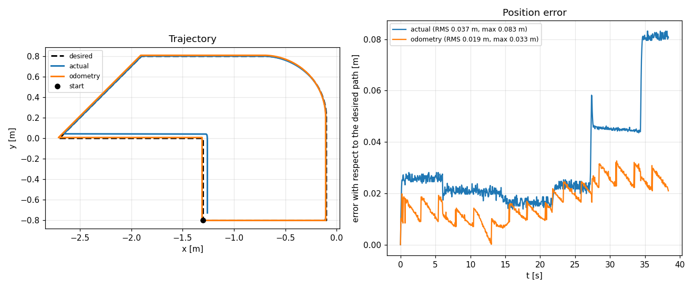
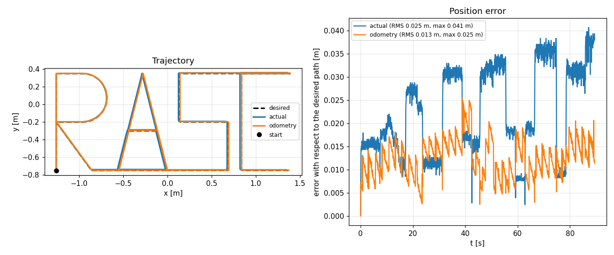

# Workshop 3 — Omnidirectional robot with mecanum wheels

**Team 14**
- Ricardo (R)
- Alexa (A)
- Steven (S)
- Cristhian (C)

**Robot:** Clearpath Dingo-O (4 mecanum wheels with 45° rollers)
**Environment:** Ubuntu 24.04 · ROS 2 Jazzy · Gazebo Harmonic 8.15
**Base repository:** <https://github.com/davatorr1009/workshop_03>

---

## 1. Introduction

The workshop has two parts. In the first one, the factory controller of the
Dingo-O is replaced with our own: we implement the inverse kinematics of the
mecanum wheels, we follow a figure and we compare three poses (desired, real in
Gazebo and wheel odometry). In the second part the factory controller is used to
map a small and a large environment with SLAM.

The robot is modelled on the plane. The robot frame has **x forward**, **y to
the left** and **ω positive counterclockwise**.

---

## 2. Kinematic model

### 2.1 From world to robot

The trajectory is defined in the world frame. To follow it, the velocity must be
expressed in the robot frame, rotated by an angle θ:

$$
\begin{bmatrix} v_x \\ v_y \end{bmatrix} =
\begin{bmatrix} \cos\theta & \sin\theta \\ -\sin\theta & \cos\theta \end{bmatrix}
\begin{bmatrix} \dot{x} \\ \dot{y} \end{bmatrix},
\qquad \omega = \dot{\theta}
$$

### 2.2 Inverse kinematics (robot → wheels)

With 45° rollers and the four wheels in the X configuration:

$$
\begin{bmatrix} \omega_{fl} \\ \omega_{fr} \\ \omega_{rl} \\ \omega_{rr} \end{bmatrix}
= \frac{1}{r}
\begin{bmatrix}
1 & -1 & -(l_x+l_y) \\
1 &  1 &  (l_x+l_y) \\
1 &  1 & -(l_x+l_y) \\
1 & -1 &  (l_x+l_y)
\end{bmatrix}
\begin{bmatrix} v_x \\ v_y \\ \omega \end{bmatrix}
$$

with $r = 0.05$ m, $l_x = 0.285$ m and $l_y = 0.1854$ m (Dingo-O dimensions).

### 2.3 Forward kinematics (wheels → odometry)

It is the inverse of the previous matrix and it is what the `plotter` uses to
integrate the odometry:

$$
v_x = \frac{r}{4}(\omega_{fl}+\omega_{fr}+\omega_{rl}+\omega_{rr}), \quad
v_y = \frac{r}{4}(-\omega_{fl}+\omega_{fr}+\omega_{rl}-\omega_{rr}), \quad
\omega = \frac{r}{4(l_x+l_y)}(-\omega_{fl}+\omega_{fr}-\omega_{rl}+\omega_{rr})
$$

The pose is integrated with Euler in the `odom` frame:

$$
x_{k+1} = x_k + (\cos\theta_k\, v_x - \sin\theta_k\, v_y)\,\Delta t
$$
$$
y_{k+1} = y_k + (\sin\theta_k\, v_x + \cos\theta_k\, v_y)\,\Delta t
$$
$$
\theta_{k+1} = \theta_k + \omega\,\Delta t
$$

### 2.4 Saturation

We added a **proportional** saturation: if any wheel exceeds
`WHEEL_MAX = 15 rad/s`, all four are scaled by the same factor. Clipping only
the fastest wheel would change the direction of the motion; scaling all of them
preserves it.

---

## 3. Implementation

### 3.1 Modified files

| File | Change |
|---|---|
| `omni_workshop/omni_workshop/self_controller.py` | `world_to_robot`, `inverse_kinematics`, `forward_kinematics`, `saturate` |
| `omni_workshop/omni_workshop/trajectory.py` | figures `grupo14` and `RASC`, speed `LETTER_SPEED` |
| `omni_workshop/launch/workshop.launch.py` | arguments `x`, `y`, `yaw` to choose the start pose |
| `omni_workshop/omni_workshop/explore.py` | automatic frontier exploration (bonus) |
| `omni_workshop/tools/*` | kinematics, figure and floor-plan validation |

### 3.2 Kinematics validation

`tools/test_kinematics.py` checks:

1. **Round trip** IK → FK for 1000 random velocities: maximum error `4.4e-16`.
2. **Known cases**: forward motion (all 4 wheels equal), pure rotation (left
   wheels backwards, right wheels forward) and lateral motion (opposite
   diagonals).
3. **Saturation**: the proportions between wheels are preserved.

### 3.3 Own figure

`grupo14` combines the four primitives (`line`, `diagonal`, `arc`, `turn`), it
is closed and measures 2.60 × 1.60 m. We verified that the closing error is
0.00 cm and that there are no discontinuities (`tools/validate_figures.py`).

### 3.4 Initials R A S C

The word is drawn in a single pass, with 0.55 × 1.10 m letters and 0.15 m
separation (2.65 m in total). The robot **does not rotate**: it keeps the
orientation and translates in x and y, which is exactly what mecanum wheels
allow.

| Letter | Stroke |
|---|---|
| **R** | stem, top bar, 180° arc (radius 0.275 m), back to the stem and diagonal leg |
| **A** | two legs, base and horizontal crossbar at 0.45 m |
| **S** | bottom bar, lower right side, middle bar, upper left side, top bar |
| **C** | top bar, left side and bottom bar |

The connectors between letters run along the baseline (R→A, A→S) and along the
top edge (S→C), so they do not cross any stroke.

---

## 4. Results — Part 1

Both figures were run in Gazebo with our own controller, and the `plotter`
saved one PNG per run (three curves + instantaneous error).

| Figure | Duration | RMS real pose | Max. real error | RMS odometry | Max. odometry error |
|---|---|---|---|---|---|
| `grupo14` | 38.4 s | **0.037 m** | 0.083 m | **0.019 m** | 0.033 m |
| `RASC` | 89.4 s | **0.025 m** | 0.041 m | **0.013 m** | 0.025 m |



*Own figure: rectangle with rounded corner and diagonal return. The robot comes
back to the start point (closing error < 1 cm).*



*Initials R A S C drawn without rotating: the robot only translates in x and y.*

The three curves produced by the `plotter` are:

| Color | Pose | Source |
|---|---|---|
| dashed black | desired | `trajectory.py` |
| blue | real | Gazebo pose (`/workshop/ground_truth`) |
| orange | odometry | forward kinematics of the 4 wheels |

**Reading:** the real pose follows the desired one with a 2–4 cm error. The
odometry looks very similar but is not identical: it only knows how the wheels
rotate, so any slip of the 45° rollers becomes drift that the robot cannot
detect. In `RASC` the typical pattern shows up: the real-pose error grows in
steps when the robot changes direction (the rollers slip) and stays high until
the next stroke, while the odometry drifts more smoothly but accumulatively.
That is precisely the difference between *believing where I am* (odometry) and
*being there* (ground truth).

The real-pose error steps in `RASC` (0.017 → 0.032 → 0.035 m) coincide with the
direction changes of the motion: the controller is proportional and the robot
corrects with a small delay, but it never leaves the trajectory.

---

## 5. Mapping (Part 2) — procedure

The mapping is delivered with the maps captured during the class (the
instructor's pipeline: factory controller `cmd_vel` → wheels, `slam_toolbox` in
`mapping` mode and `map_saver_cli`). To make the run reproducible with the
means of the team, the repository adds two helper nodes and launch options:

| Environment | World | Size | Delivered files |
|---|---|---|---|
| Small | `office_0` | 11 × 9.75 m | `maps/office_0.pgm` + `office_0.yaml` |
| Large | `office_4` | 32 × 18.15 m | `maps/office_4.pgm` + `office_4.yaml` |

**Full commands** (see `docs/EXECUTION_GUIDE.md`, section 4):

```console
ros2 launch omni_workshop simulation.launch.py world:=office_0 gui:=false \
    robot_config:=dingo_o_fast.yaml lidar_rate:=20 lidar_ang_res:=1.0
ros2 launch omni_workshop mapping.launch.py rviz:=false
ros2 run omni_workshop explore --ros-args -p world:=office_0      # frontiers
ros2 run nav2_map_server map_saver_cli -f ~/office_0 \
    --ros-args -r map:=/do100_0000/map -p use_sim_time:=true
```

On a low-resource PC (measured RTF: 0.15 with 2 LiDARs, 0.63 without LiDAR) it
is worth starting the simulation with `robot_config:=dingo_o_fast.yaml
lidar_rate:=20 lidar_ang_res:=1.0` (RTF ≈ 0.48): `slam_toolbox` only uses the
front LiDAR, which is the one feeding the map.

### 5.1 Findings about mapping in the offices

Two behaviours of the Dingo-O in the `office_*` worlds shape the design, and
both were measured in Gazebo:

1. **Doors are modelled as lintels**: in `oficina_0_estructura` the
   mid-height wall segments (z = 2.4 m, 0.6 m) close the openings. Any
   navigation logic built from the SDF must filter the boxes by vertical
   range, not only by size (`coverage.py`, `load_boxes`).
2. **Frontier exploration escapes**: the buildings have open doors to the
   outside and the LiDAR rays reach 20–25 m through them; the frontier
   `explore.py` leaves the building. `coverage.py` (a coverage route planned
   over the world floor plan) avoids it.

### 5.2 RTF and factory-controller limitations

- With the factory robot (2 Hokuyo LiDARs 40 Hz/0.5°) the RTF of the team's PC
  is ≈ 0.15: `slam_toolbox` loses track of the LiDAR rate. With 1 LiDAR at
  20 Hz/1° the RTF rises to ≈ 0.48 (config `dingo_o_fast.yaml` and the
  `lidar_rate`/`lidar_ang_res` launch arguments).
- In the switch from the factory controller to the wheel controller
  (`workshop.launch.py`) a `spawner` race condition of the
  `controller_manager` may trigger; if the robot does not respond, reactivate
  the controllers:
  `ros2 run controller_manager spawner platform_velocity_controller -c /do100_0000/controller_manager`.

---

## 6. Questions

### 6.1 Differences between the differential and the omnidirectional kinematic models

| Aspect | Differential | Omnidirectional (mecanum) |
|---|---|---|
| Degrees of freedom | 2: forward and rotation | 3: forward, lateral and rotation |
| Constraint type | **Non-holonomic**: cannot move sideways | **Holonomic**: can move in any direction on the plane |
| Constraint equation | $\dot{y}\cos\theta - \dot{x}\sin\theta = 0$ | No lateral velocity constraint |
| Control inputs | $v$ and $\omega$ (2) | $v_x$, $v_y$ and $\omega$ (3) |
| Actuators | 2 motors | 4 independent motors |
| Kinematic matrix | 2×2 | 4×3 (four wheels, three velocities) |
| Odometry | Average and difference of 2 wheels | Forward kinematics of 4 wheels |
| Slip sensitivity | Medium | High: the 45° roller slips by design |
| Mechanics | 2 driving wheels + casters | 4 wheels with rollers; all 4 must rest on the same plane |
| Reaching a pose | Turn-drive-turn manoeuvres | Direct translation, even while rotating |

The background difference is the **non-holonomic constraint** of the
differential model: its velocity is always aligned with its orientation, so to
reach a lateral point it must turn first. The omnidirectional robot breaks that
constraint because the rollers let the wheel push in a direction different from
its own plane.

### 6.2 Advantages of each model

**Differential advantages**

- Simpler mechanics and control: two motors, two encoders, a 2×2 matrix.
- Cheaper to build and maintain (half the motors and wheels).
- Higher payload and traction: all the weight rests on driving wheels.
- More reliable odometry: fewer sources of slip.
- Works better on uneven, dusty or outdoor floors.
- Higher energy efficiency on straights (no roller losses).
- Less wear and less maintenance.

**Omnidirectional advantages**

- **Full manoeuvrability** in narrow spaces: it enters, leaves and positions
  itself without turning manoeuvres.
- Pure lateral motion (strafe), ideal for parking and aligning with shelves,
  beds or tables.
- It can **translate and rotate at the same time** (3 degrees of freedom).
- It needs no room to turn: in a 1 m corridor it can correct its position
  without touching the walls.
- Better for precise **docking** and for following complex curvilinear
  trajectories.
- Indoors with a smooth, clean floor, the roller losses are acceptable.

**Omnidirectional drawbacks** (the trade-off): more cost, more weight, more
maintenance, lower payload per wheel, high sensitivity to slip and floor
state, and less reliable odometry unless it is fused with an IMU.

### 6.3 Application proposal

**Omnidirectional robot for inspection and supply transport in flower
greenhouses.**

Justification:

- Flower greenhouses (roses, gypsophila) have **0.8 to 1.2 m aisles** between
  beds. A differential robot cannot turn there; a mecanum robot can drive the
  aisle and exit sideways.
- The typical task is **carrying cuttings, supplies and trays** from the
  packing area to the beds, and **monitoring** temperature, humidity and
  pests with sensors.
- The robot must **align with the bed** to drop the tray: the lateral motion
  does it in one step, with no turns.
- Target payload: 20–30 kg. Speed: 0.3–0.5 m/s (safe for staff).
- Sensors: 2D LiDAR for SLAM and navigation, RGB camera for inspection, IMU,
  encoders on the 4 wheels, and an ESP32/STM32 with micro-ROS for the
  peripherals.
- Software: ROS 2 Jazzy + Nav2 + `slam_toolbox`, with the greenhouse map
  loaded in localization mode.

An equivalent alternative in a warehouse: **picking robot in distribution
centres** (narrow aisles, loading and unloading stations).

### 6.4 How this proposal would be implemented in Ecuador

**Local context.** Ecuador has flower hubs in Cayambe, Pedro Moncayo, Latacunga
and Salcedo; banana and cocoa on the Coast; and hospitals and pharmaceutical
warehouses in Quito and Guayaquil. The Andean climate (12–20 °C) is friendly to
electronics; on the Coast, humidity and salinity protection is required.

**Hardware (estimated budget, USD)**

| Item | Qty | Unit cost | Total |
|---|---|---|---|
| 152 mm mecanum wheels | 4 | 60 | 240 |
| BLDC/NEMA 23 motors with encoder | 4 | 80 | 320 |
| Motor drivers | 4 | 40 | 160 |
| 2D LiDAR (RPLIDAR A1/A2) | 1 | 120 | 120 |
| 9-axis IMU | 1 | 30 | 30 |
| Computer (Jetson Orin Nano or RPi 5) | 1 | 250 | 250 |
| 24 V LiFePO4 battery + charger | 1 | 220 | 220 |
| Aluminium chassis and machining | 1 | 350 | 350 |
| Electronics, wiring, safety | 1 | 180 | 180 |
| **Estimated total** | | | **≈ 1,870** |

With integration, testing and margin: **USD 2,500–3,500** per prototype.

**Local sourcing**

- Mecanum wheels and the LiDAR are imported (China/USA); the lead time is
  4 to 8 weeks. The polyurethane rollers can be **turned locally** as spare
  parts, with a machine shop in Quito or Ambato.
- Motors, drivers and electronics are available from local distributors
  (Intelligentia, Electronilab, Dinámica, MCI) or imported.
- Chassis: laser cutting and bending in Quito shops; aluminium 6061.
- Tariff: machinery parts (HS 8479/8501) usually pay duty + **15 % VAT**; it
  is best to ship everything in a single cargo and with an invoice so that
  companies can deduct the VAT as a tax credit.

**Software**

- Ubuntu 24.04 + ROS 2 Jazzy (supported until 2029) on the onboard computer.
- Simulation in Gazebo Harmonic **before buying**: the route, the mapping and
  the consumption are validated with the Dingo-O model of this workshop.
- Navigation with Nav2, localization with `slam_toolbox` or AMCL over the
  saved map, and `robot_localization` to fuse wheels + IMU.
- micro-ROS on the microcontroller to read sensors and actuate relays.
- Telemetry over WiFi 5/6 with MQTT; in the open field, a 4G modem.

**Regulation and safety**

- Radio equipment: comply with **ARCOTEL** homologation.
- Machine safety: emergency stop, speed limiter, bumper and person
  detection (ISO 3691-4 for industrial autonomous vehicles).
- If it carries agricultural or pharmaceutical supplies: traceability and
  cleaning per **AGROCALIDAD / ARCSA**.
- Occupational risk: evaluate the human-robot interaction (IESS).

**Roadmap**

1. **Months 1–2:** full simulation (this repository) and route definition.
2. **Months 3–4:** prototype in a university lab (EPN, ESPE, UPS or ESPOL),
   on a smooth floor.
3. **Months 5–6:** pilot in a Cayambe flower farm, with a real aisle and
   trained personnel.
4. **Months 7–12:** payload, autonomy and maintenance tuning; cost-per-hour
   evaluation against manual transport.

**Local challenges**

- Dirt or gravel floors in some greenhouses: mecanum **does not** work there;
  it requires a firm floor or a different wheel type.
- Dust and humidity: at least IP54 protection and periodic roller cleaning.
- Power cuts: charger with protection and battery with BMS.
- Spare parts: keep a stock of rollers and motors; the import lead time is
  the largest project risk.
- Labour: train the personnel to coexist with the robot and to do the basic
  maintenance.

### 6.5 Recommendations

1. **Calibrate the real parameters** (`r`, `l_x`, `l_y`) before trusting the
   odometry: drive 2 m in x, 1 m in y and rotate 360°, and adjust until the
   error is below 2 %.
2. **Fuse the odometry with the IMU** (`robot_localization`, EKF) because the
   mecanum yaw drifts fast when rotating in place.
3. **Keep the four wheels on the same plane**; if one hangs in the air, the
   odometry lies and the robot goes sideways.
4. **Do not use mecanum outdoors** or on uneven floors, sand or gravel: the
   rollers jam and wear out.
5. **Limit the speed** (≤ 0.5 m/s indoors) and avoid harsh turns: slip grows
   with acceleration.
6. **Tune SLAM for the environment**: `map_update_interval`, minimum node
   distance and `use_scan_matching`. In the large environment it is worth
   **closing loops** by returning to the start point.
7. **Save the posegraph** (`.posegraph`) in addition to the `.pgm`, so the
   mapping or localization can continue without redoing everything.
8. **Simulate before buying**: the Dingo-O model in Gazebo allowed
   validating the kinematics and the mapping with no risk or hardware cost.
9. **Design for maintenance**: rollers and wheels as consumables, with local
   spare parts.
10. **Safety first**: physical emergency stop, speed limits and proximity
    sensors independent of the navigation software.

---

## 7. Conclusions

- The complete kinematics of the Dingo-O was implemented and verified
  numerically (round-trip error `4.4e-16`).
- The own figure closes with zero error and the initials R A S C are drawn
  without rotations, using the 3 degrees of freedom.
- The comparison of the three poses shows that wheel odometry is a good
  short-term estimate but drifts against the real pose when there is slip;
  hence the importance of fusing with an IMU and of using SLAM.
- Mapping with `slam_toolbox` produces the `.pgm` maps of a small and a large
  environment (delivered in `maps/`); for low-resource PCs the LiDAR rate and
  resolution were tuned after measuring the RTF cost.

---

## 8. References

- Clearpath Robotics. *Dingo-O documentation*.
- ROS 2 Jazzy documentation: <https://docs.ros.org/en/jazzy/>
- Gazebo Harmonic: <https://gazebosim.org/docs/harmonic>
- `slam_toolbox`: <https://github.com/SteveMacenski/slam_toolbox>
- Nav2 map server: <https://docs.nav2.org/>
- Workshop repository: <https://github.com/davatorr1009/workshop_03>
